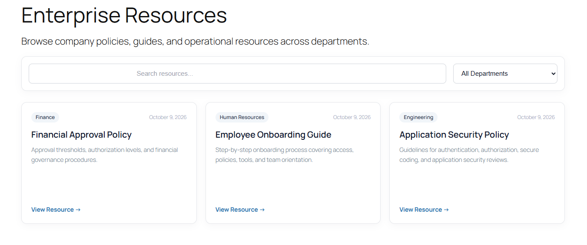
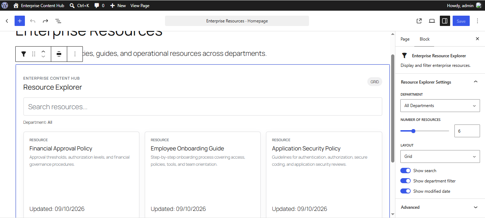
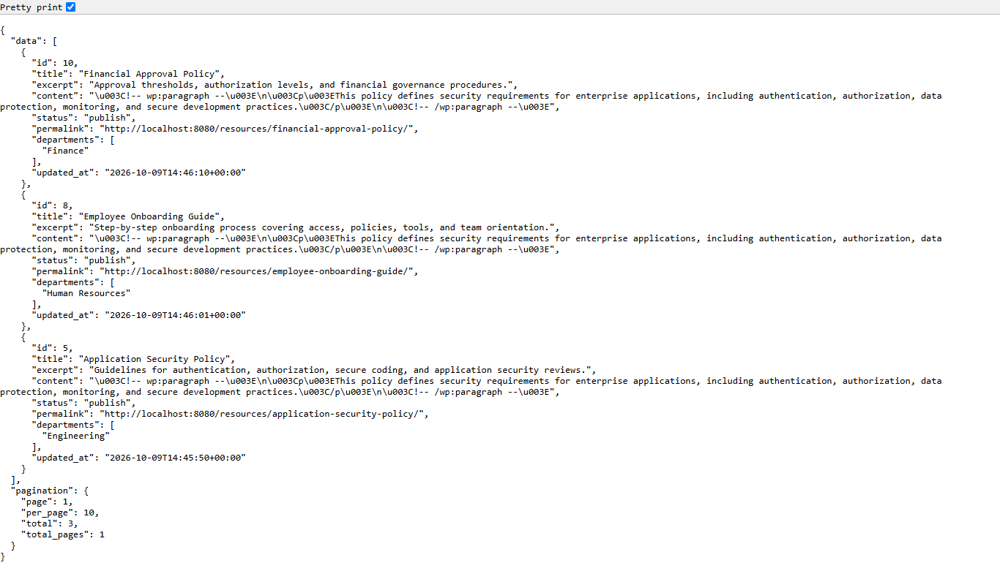
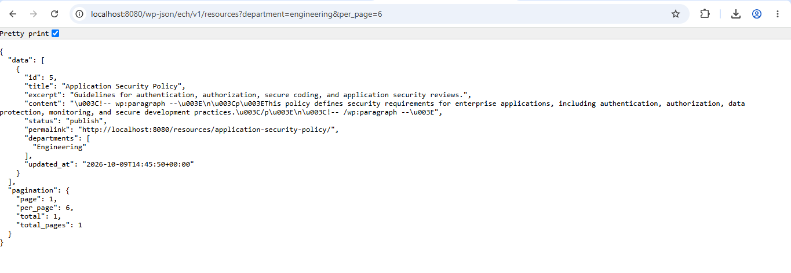
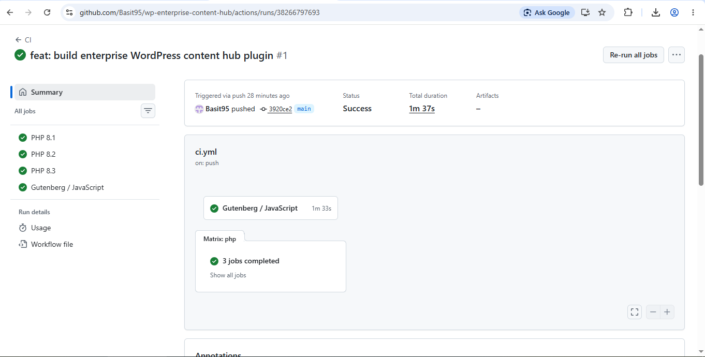

# WP Enterprise Content Hub

[](https://github.com/Basit95/wp-enterprise-content-hub/actions/workflows/ci.yml)

Enterprise-oriented WordPress plugin demonstrating scalable plugin architecture, Gutenberg development, REST APIs, automated testing, repository and service patterns, caching, WP-CLI tooling, coding standards, Docker-based local development, and CI/CD.

## Features

- Custom `Resource` post type
- Custom `Department` taxonomy
- REST API endpoints
- Search and department filtering
- React-based Gutenberg block
- Dynamic frontend resource explorer
- Custom WordPress capabilities
- Repository pattern
- Service layer architecture
- Repository-level caching
- Cache abstraction through `CacheStore`
- Automatic cache invalidation
- WordPress transient cache implementation
- WP-CLI cache management
- WP-CLI resource seeding
- Idempotent demo data seeding
- Portable REST endpoint handling
- Secure frontend DOM rendering
- PHPUnit unit tests
- Cached repository unit tests
- WordPress Coding Standards with PHPCS
- JavaScript and SCSS linting
- Docker-based local development
- Docker WP-CLI integration
- GitHub Actions CI
- PHP 8.1, 8.2, and 8.3 CI validation
- Responsive grid and list layouts

## Screenshots

### Enterprise Resource Explorer



Searchable and filterable frontend resource directory with department metadata, responsive resource cards, and dynamic filtering.

### Gutenberg Block Editor



Custom React-based Gutenberg block with configurable department, number of resources, layout, search visibility, department filtering, and modified date controls.

### REST API



Custom REST API exposing enterprise resources with structured response data and pagination metadata.

### Department Filtering



REST API filtering resources by department using the custom `department` query parameter.

### GitHub Actions CI



Automated CI pipeline validating PHP 8.1, PHP 8.2, PHP 8.3, PHPUnit, PHPCS, JavaScript, SCSS, and Gutenberg production builds.

## Architecture

The plugin separates WordPress-specific infrastructure from application and domain logic to improve maintainability, testability, extensibility, and operational reliability.

```text
src/
├── Application/
│   └── ResourceQuery.php
├── Blocks/
│   └── ResourceExplorerBlock.php
├── Cache/
│   └── ResourceCacheInvalidator.php
├── Cli/
│   ├── CacheCommand.php
│   └── ResourceCommand.php
├── Content/
│   ├── ResourcePostType.php
│   └── ResourceTaxonomy.php
├── Contracts/
│   ├── CacheStore.php
│   └── ResourceRepository.php
├── Domain/
│   └── Resource/
│       └── Resource.php
├── Infrastructure/
│   ├── CachedResourceRepository.php
│   ├── WordPressResourceRepository.php
│   └── WordPressTransientCache.php
├── Lifecycle/
│   ├── Activator.php
│   └── Deactivator.php
├── Rest/
│   ├── DepartmentController.php
│   └── ResourceController.php
├── Security/
│   └── Capabilities.php
├── Services/
│   └── ResourceService.php
└── Plugin.php
```

### Request Flow

```text
Gutenberg Block / REST Request
            ↓
      ResourceService
            ↓
 CachedResourceRepository
       ↓            ↓
  Cache Hit     Cache Miss
                    ↓
     WordPressResourceRepository
                    ↓
                 WP_Query
```

The `ResourceRepository` contract allows the application layer to remain independent from direct WordPress query implementation details.

The `CachedResourceRepository` decorates the repository implementation and adds caching without changing the service layer.

The `CacheStore` abstraction keeps cache storage independent from the application layer.

Detailed architecture documentation is available in:

```text
docs/architecture.md
```

Architecture decisions are documented under:

```text
docs/adr/
```

## Caching

The plugin includes repository-level caching for resource queries.

### Cache Contract

```text
src/Contracts/CacheStore.php
```

The cache contract provides:

```text
get()
set()
flush()
```

### WordPress Cache Implementation

```text
src/Infrastructure/WordPressTransientCache.php
```

The default implementation uses the WordPress Transient API.

### Cached Repository

```text
src/Infrastructure/CachedResourceRepository.php
```

The cached repository handles:

- Individual resource lookups
- Resource search results
- Resource counts

### Cache Invalidation

Cache invalidation is handled by:

```text
src/Cache/ResourceCacheInvalidator.php
```

The cache is invalidated when:

- A resource is created
- A resource is updated
- A resource is deleted
- Resource department assignments change
- A department is created
- A department is updated
- A department is deleted

The cache implementation uses versioned cache keys.

Instead of scanning and deleting every transient, the cache version is incremented so previous cache entries are no longer used and can expire naturally.

## REST API

Base namespace:

```text
/wp-json/ech/v1
```

Available endpoints:

```text
GET /resources
GET /resources/{id}
GET /departments
```

### Resource Collection

```text
GET /wp-json/ech/v1/resources
```

Supported query parameters:

| Parameter | Description |
|---|---|
| `search` | Search resources by keyword |
| `department` | Filter by department slug |
| `page` | Pagination page number |
| `per_page` | Resources per page, maximum 50 |

Example:

```text
/wp-json/ech/v1/resources?search=security&department=engineering&page=1&per_page=6
```

Example response structure:

```json
{
  "data": [],
  "pagination": {
    "page": 1,
    "per_page": 6,
    "total": 0,
    "total_pages": 0
  }
}
```

### Individual Resource

```text
GET /wp-json/ech/v1/resources/{id}
```

Returns a single resource by ID.

### Departments

```text
GET /wp-json/ech/v1/departments
```

Returns available resource departments including IDs, names, slugs, and resource counts.

## Gutenberg Block

The plugin includes a custom block:

```text
Enterprise Resource Explorer
```

The block provides:

- Department selection
- Configurable resource count
- Grid and list layouts
- Search visibility control
- Department filter visibility control
- Modified date visibility control
- Editor preview
- Dynamic frontend filtering
- Responsive frontend rendering

Source files are located in:

```text
blocks/resource-explorer/
```

Production assets are generated into:

```text
build/resource-explorer/
```

The frontend REST endpoint is generated by WordPress using:

```php
rest_url( 'ech/v1/resources' )
```

rather than relying on a hardcoded `/wp-json/` URL.

This improves compatibility with WordPress subdirectory installations and custom URL configurations.

## Security

The plugin includes:

- Custom WordPress capabilities
- Sanitized REST API parameters
- Validated pagination parameters
- Escaped frontend output
- Published-resource visibility rules
- Capability assignment during plugin activation
- Portable REST URL generation
- Safe dynamic frontend DOM rendering

Custom capabilities are managed through:

```text
src/Security/Capabilities.php
```

Dynamic frontend resource rendering uses DOM APIs such as `textContent` instead of inserting REST response values directly through raw `innerHTML`.

## Plugin Lifecycle

During activation the plugin:

1. Adds custom resource capabilities
2. Registers the Resource post type
3. Registers the Department taxonomy
4. Flushes WordPress rewrite rules

Registering the post type and taxonomy before flushing rewrite rules ensures their permalink rules are generated correctly.

## WP-CLI

The plugin includes WP-CLI administration commands.

### Clear Cache

```bash
wp ech cache clear
```

Example:

```text
Success: Enterprise Content Hub cache cleared.
```

### Seed Demo Resources

```bash
wp ech resources seed
```

First execution:

```text
Created resource: Application Security Policy
Created resource: Employee Onboarding Guide
Created resource: Financial Approval Policy
Success: Seeding complete. Created: 3, skipped: 0.
```

The seed command is idempotent.

Running it again skips previously seeded resources:

```text
Skipped existing resource: Application Security Policy
Skipped existing resource: Employee Onboarding Guide
Skipped existing resource: Financial Approval Policy
Success: Seeding complete. Created: 0, skipped: 3.
```

## Requirements

- WordPress 6.6+
- PHP 8.1+
- Composer
- Node.js 22
- npm
- Docker Desktop

## Installation

Clone the repository:

```bash
git clone https://github.com/Basit95/wp-enterprise-content-hub.git
```

Enter the project directory:

```bash
cd wp-enterprise-content-hub
```

Install PHP dependencies:

```bash
composer install
```

Install JavaScript dependencies:

```bash
npm install
```

Build Gutenberg assets:

```bash
npm run build
```

Start the local WordPress environment:

```bash
docker compose up -d
```

Open:

```text
http://localhost:8080
```

Complete the WordPress installation and activate:

```text
WP Enterprise Content Hub
```

from the WordPress Plugins screen.

## Development

Run the Gutenberg development watcher:

```bash
npm run start
```

Build production assets:

```bash
npm run build
```

The build process:

1. Compiles the Gutenberg editor bundle
2. Generates editor and frontend CSS
3. Generates WordPress asset metadata
4. Copies `block.json`
5. Copies the frontend interaction script

## Testing

Run PHPUnit:

```bash
composer test
```

Current unit tests cover:

- Resource domain model
- Resource serialization
- Resource query defaults
- Pagination boundaries
- Resource service behavior
- Invalid resource IDs
- Repository abstraction
- Pagination metadata
- Cached individual resource lookups
- Cached missing-resource results
- Cached resource search results
- Cached resource counts

The project currently includes:

```text
15 tests
```

Test support includes:

```text
tests/Support/FakeResourceRepository.php
tests/Support/FakeCacheStore.php
```

The caching tests verify that the underlying repository is not queried repeatedly after a cache value has been stored.

## PHP Coding Standards

Run PHPCS:

```bash
composer lint
```

Automatically fix supported violations:

```bash
composer lint:fix
```

The project uses WordPress Coding Standards while retaining PSR-4 class organization.

## JavaScript Quality

Run JavaScript linting:

```bash
npm run lint:js
```

Run SCSS linting:

```bash
npm run lint:css
```

Automatically fix supported SCSS issues:

```bash
npm run lint:css:fix
```

Format Gutenberg source files:

```bash
npm run format
```

## Local Quality Gate

Before committing changes, run:

```bash
composer lint
composer test
npm run lint:js
npm run lint:css
npm run build
```

All checks should pass before code is pushed.

## GitHub Actions CI

The repository includes an automated GitHub Actions workflow.

CI runs on pushes and pull requests and validates:

### PHP

- PHP 8.1
- PHP 8.2
- PHP 8.3
- Composer configuration
- Dependency installation
- PHPCS
- PHPUnit

### Gutenberg / JavaScript

- Node.js 22
- npm dependency installation
- JavaScript linting
- SCSS linting
- Gutenberg production build
- Generated asset verification

Workflow configuration:

```text
.github/workflows/ci.yml
```

## Docker Development Environment

The repository includes a Docker Compose environment containing:

- WordPress
- MySQL 8
- WP-CLI

WordPress and WP-CLI share the same WordPress filesystem volume.

Start:

```bash
docker compose up -d
```

Stop:

```bash
docker compose down
```

View containers:

```bash
docker compose ps
```

Check WordPress through WP-CLI:

```bash
docker compose run --rm wpcli wp core version
```

Clear plugin cache:

```bash
docker compose run --rm wpcli wp ech cache clear
```

Seed demo resources:

```bash
docker compose run --rm wpcli wp ech resources seed
```

## Project Structure

```text
wp-enterprise-content-hub/
├── .github/
│   └── workflows/
│       └── ci.yml
├── blocks/
│   └── resource-explorer/
├── build/
│   └── resource-explorer/
├── docs/
│   ├── adr/
│   │   └── 001-repository-and-cache-decorators.md
│   ├── images/
│   │   ├── 01-frontend-resource-explorer.png
│   │   ├── 02-gutenberg-block-editor.png
│   │   ├── 03-rest-api.png
│   │   ├── 04-rest-api-department.png
│   │   └── 05-github-actions-ci.png
│   └── architecture.md
├── scripts/
│   └── copy-block-assets.mjs
├── src/
│   ├── Application/
│   │   └── ResourceQuery.php
│   ├── Blocks/
│   │   └── ResourceExplorerBlock.php
│   ├── Cache/
│   │   └── ResourceCacheInvalidator.php
│   ├── Cli/
│   │   ├── CacheCommand.php
│   │   └── ResourceCommand.php
│   ├── Content/
│   │   ├── ResourcePostType.php
│   │   └── ResourceTaxonomy.php
│   ├── Contracts/
│   │   ├── CacheStore.php
│   │   └── ResourceRepository.php
│   ├── Domain/
│   │   └── Resource/
│   │       └── Resource.php
│   ├── Infrastructure/
│   │   ├── CachedResourceRepository.php
│   │   ├── WordPressResourceRepository.php
│   │   └── WordPressTransientCache.php
│   ├── Lifecycle/
│   │   ├── Activator.php
│   │   └── Deactivator.php
│   ├── Rest/
│   │   ├── DepartmentController.php
│   │   └── ResourceController.php
│   ├── Security/
│   │   └── Capabilities.php
│   ├── Services/
│   │   └── ResourceService.php
│   └── Plugin.php
├── tests/
│   ├── Support/
│   │   ├── FakeCacheStore.php
│   │   └── FakeResourceRepository.php
│   ├── Unit/
│   │   ├── CachedResourceRepositoryTest.php
│   │   ├── ResourceQueryTest.php
│   │   ├── ResourceServiceTest.php
│   │   └── ResourceTest.php
│   └── bootstrap.php
├── composer.json
├── composer.lock
├── docker-compose.yml
├── enterprise-content-hub.php
├── package.json
├── package-lock.json
├── phpcs.xml.dist
├── phpunit.xml.dist
└── README.md
```

## Architecture Documentation

Detailed architecture documentation is available at:

```text
docs/architecture.md
```

Architecture Decision Records are stored in:

```text
docs/adr/
```

The repository and cache decorator decision is documented in:

```text
docs/adr/001-repository-and-cache-decorators.md
```

## Engineering Goals

This project demonstrates WordPress engineering beyond traditional theme and simple plugin development.

The main goals are:

- Modular architecture
- Separation of concerns
- Dependency inversion
- Repository pattern
- Decorator pattern
- Service layer design
- Testable business logic
- REST API design
- Modern Gutenberg development
- Cache abstraction
- Repository-level caching
- Automatic cache invalidation
- WP-CLI operational tooling
- Automated code quality
- Reproducible local development
- Continuous integration
- Production-oriented project organization

## Release

Current stable release:

```text
v1.1.0
```

### v1.1.0 Highlights

- Repository-level caching
- WordPress transient cache implementation
- Automatic resource cache invalidation
- WP-CLI cache management
- WP-CLI demo resource seeding
- Cached repository unit tests
- Improved plugin activation lifecycle
- Portable WordPress REST endpoint handling
- Safer frontend resource rendering
- Architecture documentation
- Docker WP-CLI integration

## License

GPL-2.0-or-later